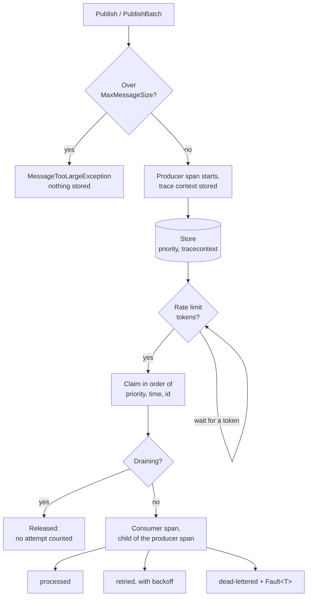
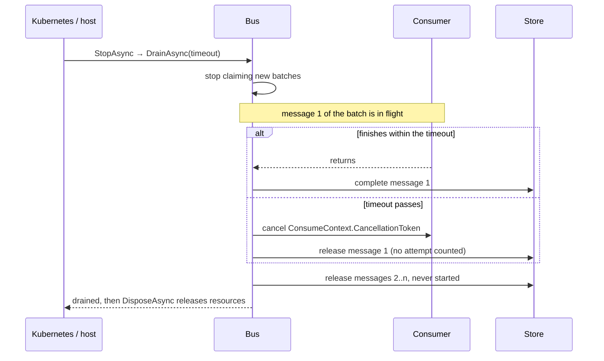

# Delivery Controls

These features work the same on every transport unless a section says otherwise. Each one is off, or keeps today's behaviour, until you set it.



## Graceful drain

`DrainAsync(timeout, cancellationToken)` stops the bus claiming new work and waits for the messages already being consumed to finish. Messages in the claimed batch that have not started go straight back to the queue. If the timeout passes (or the token is cancelled) first, each consumer's `ConsumeContext<T>.CancellationToken` is cancelled and its message is released. Released messages are **not** counted as attempts.

`DisposeAsync` drains for `BatchOptions.DrainTimeout` (default 30 s). To use the host's shutdown token instead, drain in `IHostedService.StopAsync`:

```csharp
public async Task StopAsync(CancellationToken cancellationToken)
{
    await bus.DrainAsync(TimeSpan.FromSeconds(25), cancellationToken);
    await bus.DisposeAsync();
}
```



| Transport | What releasing a message does |
|---|---|
| PostgreSQL / SQL Server, transaction mode | Nothing to undo: the row is left unchanged and the claim transaction commits |
| PostgreSQL / SQL Server with `ClaimLease`, SQLite | Clears the lease, so the message can be claimed again at once |
| Redis | Re-adds the entry with its attempt count and acknowledges the old one (it moves to the end of the stream) |

Keep the drain timeout below the host's `HostOptions.ShutdownTimeout`, and that below Kubernetes `terminationGracePeriodSeconds` (both 30 s by default). Pass `context.CancellationToken` to your consumers' I/O: a consumer that ignores it keeps its message until the claim lease expires or the claim transaction ends.

## Tracing

Every transport emits spans on the `ActivitySource` named `TownSuite.WorkQueues` (`WorkQueueTracing.ActivitySourceName`). Publishing starts a producer span and stores its W3C trace context with the message. Each delivery starts a consumer span whose parent is that context, and the span is `Activity.Current` while consumers run. A request and the work it queued appear as one trace, with no changes to consumer code. The context is kept through retries, scheduled delivery and replay.

```csharp
builder.Services.AddOpenTelemetry()
    .WithTracing(t => t.AddSource(WorkQueueTracing.ActivitySourceName).AddOtlpExporter());
```

Spans are named `publish {channel}` and `process {channel}`. They carry `messaging.system`, `messaging.destination.name`, `messaging.message.id`, `messaging.operation.type`, `townsuite.workqueues.delivery_attempt` and `townsuite.workqueues.outcome` (`processed`, `retried`, `deadlettered`, `expired` or `released`). A failed delivery has error status and an `exception` event. When nothing listens to the source no span is created, but the publisher's `Activity.Current` is still stored.

## Priority

`PublishOptions.Priority` orders delivery within a message type: lower values first, equal priorities oldest first. The default is `0`, and negative values are allowed.

```csharp
await bus.Publish(new ReceiptRequested { PaymentId = id }, new PublishOptions { Priority = -10 });
```

Supported on PostgreSQL, SQL Server and SQLite. A Redis stream has no order but arrival, so `RedisMessageBus` throws `NotSupportedException` for a non-zero priority. With `MaxConcurrency` above `1`, messages are claimed in priority order but can finish in any order.

## Batch publish

`PublishBatch` publishes many messages of one type together, all or none, and returns their ids in input order. The messages share one `PublishOptions` and are delivered in the order given (within a priority).

```csharp
IReadOnlyList<Guid> ids = await bus.PublishBatch(invoices.Select(i => new InvoiceDue { InvoiceId = i.Id }));

// On your own transaction (outbox):
await bus.PublishBatch(messages, connection, transaction);
```

| Transport | How a batch is written |
|---|---|
| PostgreSQL | One `INSERT … SELECT FROM unnest(…)` statement |
| SQL Server | One `INSERT` per 1,000 messages, in a transaction when there is more than one |
| SQLite | One prepared `INSERT` per message, in a transaction |
| Redis | `XADD`s in one `MULTI`/`EXEC`; `RedisMessageBus.PublishBatch(messages, ITransaction)` queues them on yours |

## Message size limit

`BatchOptions.MaxMessageSize` (bytes of serialised UTF-8 JSON; default `null`, no limit) rejects a message that is too large when it is published, with `MessageTooLargeException`, before anything is stored. A batch containing one is rejected as a whole. An oversized message already in the store is dead-lettered on its first claim without calling consumers; its `Fault<T>` has the `MessageTooLargeException` type and `NonRetryable = true`.

```csharp
options.MaxMessageSize = 256 * 1024;
```

## Rate limiting

`BatchOptions.MessagesPerSecond` (default `0`, no limit) caps how many messages one bus delivers per second, across all of its `MaxConcurrency` loops. Use it for consumers that call a rate-limited service, so they don't burn retries into dead-letters. Values below one are allowed (`0.5` is one message every two seconds). Tokens for a whole claim are taken before claiming, so claimed messages never wait and leases do not run down. The limit is per bus: three replicas at `5` deliver up to 15 a second.

## Upgrading

The features add two columns, which the migration hosted services create:

| Column | Type | Used by |
|---|---|---|
| `priority` | `INT NOT NULL DEFAULT 0` (SQLite `INTEGER`) | Claim order |
| `tracecontext` | `TEXT NULL` (SQL Server `NVARCHAR(1000) NULL`) | Tracing |

Every claim query reads both. If your schema is managed outside the migration services, add them, and the `(channel, priority, timecreatedutc)` index for unprocessed rows, **before** upgrading.
