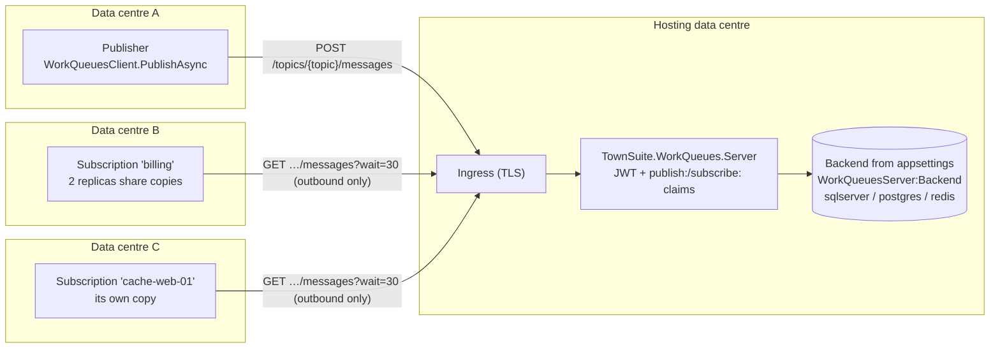
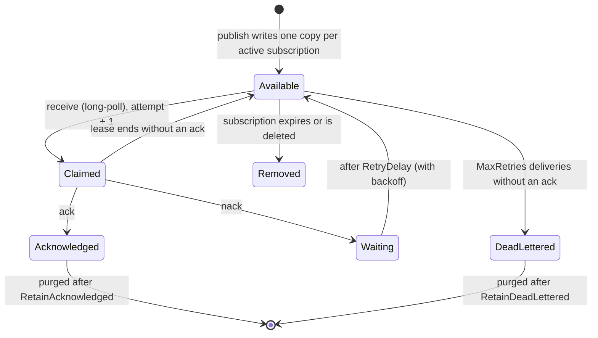

# HTTPS Server (cross-data-centre)

A message bus only reaches processes that can connect to its database or Redis, and subscribers that share a channel split its messages between them. `TownSuite.WorkQueues.Server` is an HTTPS API, hosted in one data centre, that any service can publish to or subscribe from over the VPN or the internet.

- **Fan-out:** every subscription on a topic gets its own copy of each message, so it suits messages meant for every instance, such as cache invalidation.
- **Outbound only:** subscribers make only outgoing HTTPS requests, so no inbound firewall rules are needed where they run.



## Endpoints

| Endpoint | Claim | What it does |
|---|---|---|
| `POST /api/v1/topics/{topic}/messages` | `publish:{topic}` | Publishes the JSON body, one copy per active subscription. `202 { messageId, subscriptions }` |
| `PUT /api/v1/topics/{topic}/subscriptions/{subscriberId}` | `subscribe:{topic}` | Registers or renews a subscription. It receives messages published from then on |
| `GET …/subscriptions/{subscriberId}` | `subscribe:{topic}` | `{ expiresAt, pending, deadLettered }` |
| `GET …/subscriptions/{subscriberId}/messages?wait=30&max=10` | `subscribe:{topic}` | Long-polls; returns as soon as there are messages. `404` once the subscription has expired |
| `POST …/messages/{receipt}/ack` | `subscribe:{topic}` | Acknowledges a delivery. `410` if its lease was lost and it may be delivered again |
| `POST …/messages/{receipt}/nack` | `subscribe:{topic}` | Retries after `RetryDelay`; optional body `{ "error": "…" }` |
| `DELETE …/subscriptions/{subscriberId}` | `subscribe:{topic}` | Removes the subscription and its waiting messages |
| `GET /healthz` | none | Backend reachability, for probes (plain HTTP allowed) |

Topic and subscriber names are 1–200 letters, digits, `.`, `_` or `-`, starting with a letter or digit.

## Delivery



- A received message is held for `ClaimLease` (30 s) and delivered again if it is not acknowledged. After `MaxRetries` (5) unacknowledged deliveries it is dead-lettered.
- A subscription that is neither renewed nor polled for `SubscriptionIdleTimeout` (5 min) expires, stops receiving copies, and its waiting messages are removed, so short-lived subscribers such as pods do not pile up.
- Processes that share a `subscriberId` share that subscription's copies: that is how the replicas of one service divide the work. Give each instance its own id when every instance must see every message.

## Hosting

The server is the `townsuite/workqueues-server` image, built by Jenkins from `TownSuite.WorkQueues.Server/Dockerfile` on the chiseled `aspnet:10.0-resolute-chiseled-extra` base. It runs as a non-root user and listens on port 8080. TLS is expected to end at the ingress: `X-Forwarded-Proto` is honoured, and requests that did not arrive over HTTPS get `400`.

Which backend it uses is one setting, `WorkQueuesServer:Backend`:

```json
"WorkQueuesServer": {
  "Backend": "sqlserver",
  "ConnectionString": "Server=…;Database=WorkQueues;…",
  "Jwt": { "Authority": "https://auth.example.townsuite.com", "Audience": "workqueues" }
}
```

| Setting | Default | |
|---|---|---|
| `Backend` | `postgres` | `sqlserver`, `postgres` or `redis` (recommended beyond low volume); `memory` for development only |
| `ConnectionString` | — | SQL Server, Postgres or Redis/Valkey connection string |
| `Schema` | `dbo` (SQL Server), `public` (Postgres) | Schema for the tables |
| `KeyPrefix` | `wqserver` | Prefix for the Redis keys |
| `MigrateOnStartup` | `true` | Create the SQL tables on startup |
| `MaxMessageSize` | `262144` | Larger bodies get `413` |
| `SubscriptionIdleTimeout` | `00:05:00` | Expiry of a subscription that is not polled |
| `ClaimLease` | `00:00:30` | How long a receiver holds a message |
| `MaxRetries` | `5` | Deliveries before dead-lettering |
| `RetryDelay`, `RetryBackoffMultiplier`, `MaxRetryDelay` | 5 s, `2`, 5 min | Delay after a nack |
| `RetainAcknowledged`, `RetainDeadLettered` | 1 day, 7 days | How long finished copies are kept |
| `CleanupInterval` | `00:01:00` | How often expired subscriptions are removed and storage is trimmed |
| `RequireHttps`, `TrustForwardedHeaders` | `true`, `true` | |
| `Jwt:Authority` *or* `Jwt:SigningKey` + `Jwt:Issuer` | — | OpenID Connect authority, or an HMAC key of 32+ bytes |
| `Jwt:Audience` | — | Required `aud` |
| `Jwt:TopicClaimType` | `scope` | Claim that lists topic permissions |

On SQL Server and Postgres, publishing writes one `topicdelivery` row per active subscription. On Redis or Valkey, each topic is a stream with one consumer group per subscription, so a message is written once. Changing backend does not move existing subscriptions or messages.

## Tokens

Every endpoint but `/healthz` needs a bearer token with a valid signature, issuer, audience and lifetime (otherwise `401`). Its `scope` claim (or `Jwt:TopicClaimType`) must grant the topic (otherwise `403`). Values are space-separated, or the claim can be repeated:

```
scope: "publish:fees-changed subscribe:cache-invalidation"
scope: "publish:*"          # any topic
```

Give each service a token for only the topics it needs.

## Client

`TownSuite.WorkQueues.Client` (NuGet) wraps the API:

```csharp
builder.Services.AddHttpClient("workqueues", c => c.BaseAddress = new Uri("https://workqueues.example.townsuite.com/"));
builder.Services.AddSingleton(sp => new WorkQueuesClient(
    sp.GetRequiredService<IHttpClientFactory>().CreateClient("workqueues"),
    new WorkQueuesClientOptions { AccessTokenProvider = ct => tokenCache.GetTokenAsync(ct) },
    sp.GetRequiredService<ILogger<WorkQueuesClient>>()));

// Publish
await client.PublishAsync("cache-invalidation", new CacheInvalidated { Key = "fees" });

// Subscribe from a BackgroundService: registers, long-polls, acks on success, nacks on exception,
// reconnects with backoff and re-registers an expired subscription.
await client.RunSubscriptionAsync<CacheInvalidated>("cache-invalidation", $"web-{Environment.MachineName}",
    (message, ct) => { cache.Remove(message.Message.Key); return Task.CompletedTask; },
    cancellationToken: stoppingToken);
```

`ReceiveAsync`, `AckAsync` and `NackAsync` are there for custom loops. The publisher's trace continues to subscribers: received messages carry `TraceParent`, and `RunSubscriptionAsync` starts its handler span on the `TownSuite.WorkQueues.Client` source as a child of it.

> **The server is a single point of failure for cross-data-centre messages.** Keep a fallback for when it cannot be reached, such as a cache expiry. Delivery is at least once, so make handlers idempotent: `MessageId` is the same on every copy and every redelivery.

## Capacity and the load test

`./run_loadtest.sh` runs the server and Valkey in Docker, each limited to 2 CPUs and 1 GB, and drives them with `TownSuite.WorkQueues.Server.LoadTest`. Each scenario in `TownSuite.WorkQueues.Server.LoadTest/baseline.json` is checked against its thresholds. The script exits `1` on a regression, so the Jenkins **Performance** stage fails the build. The results are written to `build/loadtest/report.json`.

Measured on a developer laptop (Docker Desktop), redis backend on Valkey 8.1:

| Scenario | Published | Copies delivered | End-to-end p50 / p99 |
|---|---|---|---|
| 4 publishers, 2 subscriptions × 16 receivers | ~3,200–3,700 msg/s | ~6,300–7,300/s | 8 ms / 75–83 ms |
| 1 publisher, 10 subscriptions × 4 receivers | ~930 msg/s | ~9,200/s | 8 ms / 57–59 ms |
| 16 publishers, consumers saturated | ~10,600 msg/s | limited by acks | — |

No run lost or duplicated a copy. The server, not Valkey, is the limit: about 11,000 HTTP requests/s on 2 CPUs, counting every publish, receive and ack, with one ack per copy. Plan on roughly 7,000–9,000 copies/s per 2-CPU replica, and add replicas to go further.

Size Valkey's memory for at least one `CleanupInterval` of messages, because acknowledged entries stay in the stream until the cleanup pass trims it. With 8 KB messages at about 3,000/s, Valkey reached about 740 MB before the trim.

```sh
./run_loadtest.sh                    # every scenario in the baseline
./run_loadtest.sh --scenario fanout  # one scenario
```

Change `baseline.json` in the same pull request as the change that justifies it. Raise the floors when the Jenkins reports show headroom; lower them only with a reason in the commit message.
